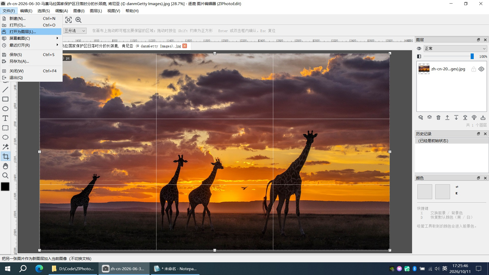
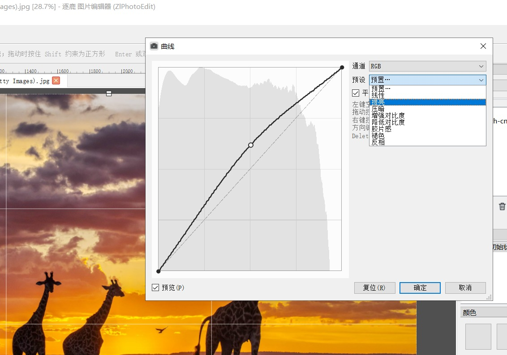

# ZlPhotoEdit

中文 | [English](README_en.md)

A lightweight Qt-based image editor for personal use. **Pure Qt, zero third-party dependencies.**

## Why I built it

Photoshop is too heavy. I only edit images occasionally, and installing a multi-gigabyte
suite and waiting for it to slowly start up every time just for a couple of tweaks is not
worth it — so I spent the time writing one myself.

The goal is plain: **fast to open, enough features, small footprint**. The main program
(excluding the Qt libraries) is **under 2 MB**: double-click and it opens — no installer,
no background services, no network access.

## Interface preview



*Multi-layer workspace: toolbox on the left, canvas in the middle (optional rulers /
guides / grid), layer panel on the right (blend modes + opacity + history + color panel),
status bar at the bottom (coordinates / size / zoom / sampled color).*



*Curves: RGB plus one curve each for R/G/B multiplied together, 12 built-in presets,
background histogram, smooth/polyline toggle; parameters preview in real time on a
downsampled copy while dragging, and the original image is completely untouched before
you confirm.*

## Features

### Layers

- Multiple layers, 22 blend modes + opacity + visibility control
- Layer panel: fully custom-drawn rows (thumbnail / name / blend mode·opacity / eye /
  lock), drag to reorder, multi-select
- Double-click or F2 to rename; move up / move down / merge down / merge visible /
  flatten / duplicate / delete
- Thumbnails refresh with 300ms throttling

### Selection

- Rectangular / elliptical marquee with **add, subtract, intersect**
  (`Shift` / `Alt` / `Shift+Alt`)
- **Feather** and anti-aliasing; `Shift` constrains to a square, `Alt` scales from the
  start point as center
- **Magic wand**: turn similar colors into a selection in one click, with optional
  **contiguous / non-contiguous** mode and a criterion based on the composite image or
  the current layer only
- Marching ants (black background + white dashed line, animated phase)
- Select all / deselect / invert selection

### Drawing tools (15)

| Tool | Description |
| --- | --- |
| Move | Drag to pan the layer; `Shift` constrains direction, `Alt` drags a copy, arrow keys for fine adjustment |
| Brush | Size 1–500, hardness 0–100, opacity, flow; the brush outline follows the mouse |
| Eraser | Erases to transparent, shares the parameter group with the brush |
| Rectangular / elliptical marquee | See "Selection" above |
| Bucket | Scanline seed fill; tolerance 0–255 (Euclidean color distance), anti-aliased transition band, contiguous / non-contiguous |
| Eyedropper | Samples the **composite** color (WYSIWYG); point / 3×3 / 5×5 average; `Alt` samples the background color |
| Magic wand | See "Selection" above |
| Line | `Shift` snaps to 8 directions |
| Rectangle / ellipse | `Shift` drags a square / circle; foreground color = stroke, background color = fill |
| Text | Click to open an input popup, `Ctrl+Enter` to confirm / `Esc` to cancel; font / size / color / bold / italic / underline / alignment / line spacing / letter spacing |
| Crop | Drag to crop with real-time dimming outside the frame, composition grid, 8 corner handles, ratio presets (free / 1:1 / 4:3 / 16:9 / 9:16) |
| Hand | Left-drag to pan the canvas with two cursor states; or hold Space to pan temporarily |
| Zoom | Click to zoom in / `Alt`-click to zoom out; drag a box to fill the viewport with that region |

### Adjustments and filters

- **Brightness / contrast**: dual sliders; both parameters are combined into a single
  LUT applied in one lookup
- **Hue / saturation**: hue ±180°, saturation / lightness ±100, all three parameters
  computed in one pass
- **Curves**: RGB + red / green / blue curves multiplied together, 12 presets, control
  points can be added, deleted and dragged
- **Levels**: input black / white point + gray gamma + output black / white point, three
  draggable handles under the histogram, with "Auto"
- Sharpen, blur, desaturate, invert
- All adjustment dialogs use a **downsampled preview** (longest side 1024): up to 60fps
  while dragging, and canceling costs nothing

### Size and geometry

- **Image size**: pixel scaling + resampling (nearest / bilinear / self-implemented
  bicubic / Lanczos); pixel or percentage input
- **Canvas size**: no resampling, container only; 3×3 anchor grid + extension color;
  smart fit when shrinking; pixel or percentage input
- **Rotate**: multiples of 90° (lossless) / arbitrary angles (the canvas auto-expands to
  the bounding box, content is never cropped)
- **Flip**: horizontal / vertical
- **Crop**: interactive tool cropping, or "Image → Crop" to crop to the selection
  bounding box in one click
- **Zoom**: view-matrix based, supports fit to window / actual size / preset levels

### Files and clipboard

- New / open / **open as layer** (turn another whole image into a new layer of the
  current document) / save / save as
- Formats: BMP / GIF / **ICO (self-written encoder)** / JPEG / PNG / SVG / TGA / TIFF /
  WBMP / WebP
- **Save as ICO**: hard limit of `≤512`; oversize requests are rejected with an
  explanation (Qt's qico is not used — it silently scales 300×300 down to 256)
- Auto-orients on open according to **EXIF**
- Copy / cut / paste selection, two-way compatible with the system clipboard; paste as a
  new layer / paste into the current layer
- Unsaved-changes prompt; multiple command-line arguments or dragging in multiple files
  all open as multiple pages

### Multi-tab

- Multiple documents at once, and **each page has its own document + undo stack + view
  state** (zoom / pan never interfere with each other)
- Tabs have `×` and unsaved markers (`*`); closing the window asks about unsaved
  content page by page

### View aids

- **Rulers**: top / left, units switchable between **px / cm / mm / inch / pt**
- **Guides**: drag out from the rulers, can be dragged / locked / cleared
- **Grid**: spacing (presets 8/16/32/64/128/256 + custom 4–2000), line color, **snap
  alignment**
- All three are **view aids only and structurally never enter exported images**
- Navigator panel; the status bar shows coordinates / image size / zoom ratio / sampled
  color / undo stack usage

### Screenshot

- "File → Screenshot": **capture now** / **delay 3 / 5 / 10 seconds**
- Capture-now also has a **global hotkey `Ctrl+Alt+S`** — it works even when the program
  is minimized
- Captures the screen under the cursor and opens the result as an **in-memory document
  page** (nothing is written to disk)

### Undo / redo

- Based on `QUndoStack` with a 30-step undo limit; the history panel allows
  click-to-jump
- Brush / shape invalidate by **dirty rectangle** with the whole stroke as one entry;
  filters / adjustments / transforms / crop use **whole-layer snapshots**

### Platform adaptation

- High-DPI scaling
- Memory degradation and error handling

## Build and run

```bash
# 0) Environment: Qt 5.15.x (MSVC build) + Visual Studio 2022;
#    prepare the compiler environment in Git Bash first
source build_env.sh

# 1) Build — method one: qmake (same as Qt Creator)
mkdir -p build && cd build && qmake ../ZlPhotoEdit.pro -spec win32-msvc "CONFIG+=release" && nmake -nologo

# 1) Build — method two: CMake + Ninja
cmake -S . -B build_cmake -G Ninja -DCMAKE_BUILD_TYPE=Release && cmake --build build_cmake

# 2) Run
./build/release/ZlPhotoEdit.exe          # qmake output
./build_cmake/bin/ZlPhotoEdit.exe        # CMake output
```

Environment requirements, details of both build methods, build pitfalls, release
packaging and directory structure are all in
[**docs/构建与运行.md**](docs/构建与运行.md) (Chinese).

## Naming and icon

> **Program name**: Chinese **逐鹿 图片编辑器**, English **ZlPhotoEdit**, both from
> `src/ui/AppInfo.h`; the window title, taskbar, "About" box and quit prompt all take it
> from there — no program-name literals appear in the code.
>
> ★ **The English name doubles as the QSettings storage path** (registry
> `HKCU\Software\ZlStudio\ZlPhotoEdit`), and once released it cannot change — changing it
> would reset all user settings.
>
> The **icon** has two layers, both provided by the same `logo`: the window / taskbar
> icon goes through `resources/logo.svg` → qrc; the exe file's own icon goes through
> `resources/logo.ico` → `resources/app.rc` → PE resource section (cannot be changed at
> runtime).

## Development documentation

All development documents are written in Chinese.

| Document | Contents |
| --- | --- |
| [docs/构建与运行.md](docs/构建与运行.md) | Environment requirements, qmake / CMake build methods, build pitfalls, release packaging, directory structure |
| [docs/自检与验证.md](docs/自检与验证.md) | How to run the offline self-tests (short names / full suite), how to test the UI without a display, guarding against "false green", static reconciliation of menu actions |
| [docs/图标体系.md](docs/图标体系.md) | The single source of the 84 hand-drawn SVGs, why `QSvgRenderer` must be used explicitly, third-party reconciliation and quality criteria |
| [docs/实现要点详解.md](docs/实现要点详解.md) | Item-by-item explanations of "why it is written this way": adjustment preview mechanism, selection, layer panel, cross-image import, ICO export, brush undo strategy |
| [docs/实现铁律.md](docs/实现铁律.md) | **Cross-phase, cross-module implementation constraints** (the pitfalls that fail silently) — read the relevant chapter before touching any module |
| [docs/架构规划.md](docs/架构规划.md) | Overall architecture, module division, key technical difficulties, engineering configuration (main document) |
| [docs/曲线调整设计.md](docs/曲线调整设计.md) | Dedicated design of the curves feature |
| [docs/画布与文件操作设计.md](docs/画布与文件操作设计.md) | Dedicated design of size / rotation / clipboard / save as / screenshot |
| [docs/性能优化评估.md](docs/性能优化评估.md) | Measured diagnosis of large-image editing lag and evaluation of optimization plans (with measured data) |
| [docs/功能覆盖审计.md](docs/功能覆盖审计.md) | Feature gap inventory, priorities and disposition records |
